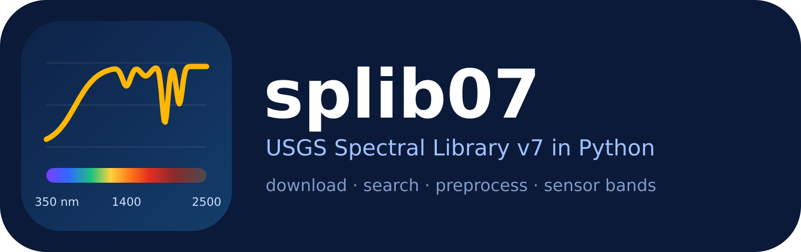
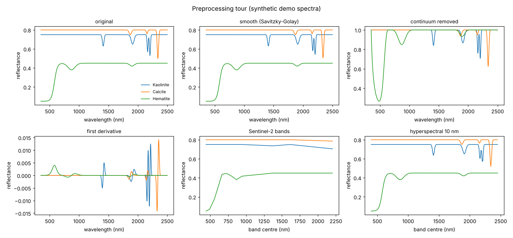
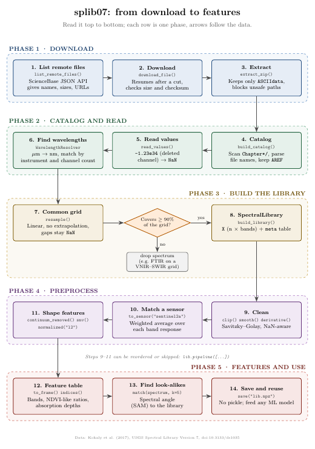

<p align="center"></p>

# usgs-splib07

**A small Python API for the USGS Spectral Library Version 7 (splib07): get the spectra with one call, look things up, and preprocess them (resample, sensor bands, smoothing, derivatives, continuum removal, normalisation, spectral angle).**

```python
import usgs_splib07 as splib

lib = splib.get_library()                        # downloads once, builds once, then loads from a cache
lib.search("kaolinite")                          # find spectra by name
lib.to_sensor("sentinel2a").normalized("l2")     # the library as Sentinel-2 would record it
```

**Scope.** This package stops at *spectra*: data access and preprocessing. Comparing the library with satellite
images is a different job and lives in a separate project, which can build on this one
(for example `lib.to_sensor(...)` gives the library on the bands of any sensor).

> Not affiliated with or endorsed by the U.S. Geological Survey. The data are theirs, see [Data and citation](#data-and-citation).

## Contents

[Install](#install) · [Quick start](#quick-start) · [Examples](#examples) · [Command line](#command-line) ·
[Function catalogue](#function-catalogue) · [How it works](#how-it-works) · [Data and citation](#data-and-citation) · [Author](#author)

## Install

```bash
pip install "git+https://github.com/yamenetoo/RremoteSensing.git#subdirectory=USGS"
# or from a clone, for development:  pip install -e ".[dev]"
```

Python 3.9+. Required: numpy, scipy, pandas, requests. Optional: `matplotlib` (plots), `tqdm` (progress bars).

## Quick start

```python
import usgs_splib07 as splib

lib = splib.get_library(chapters="MS")     # M = minerals, S = soils and mixtures
print(lib)                                 # SpectralLibrary(n=..., bands=431, 350-2500 nm, ...)
```

The first call downloads the oversampled ASCII archive from USGS ScienceBase into `~/.usgs_splib07`
(set `USGS_SPLIB07_HOME` to change it), builds a 5 nm VNIR-SWIR library, and saves it as `.npz`.
Every later call with the same arguments loads that file in about a second. Chapters are letters from
`MSCLOAV` (minerals, soils, coatings, liquids, organics, artificial, vegetation; `None` = all).
Downloads resume after a cut and are checked by size and checksum.

## Examples

The examples below run **offline** on `splib.demo_library()`, eight *invented* spectra with the same structure as the
real library, so that you can try every function in seconds. Swap that first line for `splib.get_library()` to use the real
data. Blocks continue from one another. Outputs shown were produced by running the code.
(The download itself has been tested against a local mock server and could not be run against the live USGS site from the
development environment: if it fails for you, please open an issue with the message.)

### 1. Look around

<!-- run -->
```python
import numpy as np
import usgs_splib07 as splib

lib = splib.demo_library()                 # real data: lib = splib.get_library()
print(lib)
print(lib.materials().head(3).to_string(index=False))
hits = lib.search("calc")                  # case-insensitive, searches the "name" column
print(hits[["name", "material", "chapter_name"]])
y = lib.spectrum("Calcite_SYN1_ASDFRb_AREF")   # or lib.spectrum(3): a 1-D array on lib.wavelengths
print(y.shape, round(float(y.min()), 3))
```
<!-- out -->
```text
SpectralLibrary(n=8, bands=2151, 350-2500 nm, steps=['synthetic'])
material chapter chapter_name  n_spectra
 Alunite       M     Minerals          1
 Calcite       M     Minerals          1
Dolomite       M     Minerals          1
                       name material chapter_name
3  Calcite_SYN1_ASDFRb_AREF  Calcite     Minerals
(2151,) 0.5
```
<!-- /out -->

`lib.plot("calc")` draws the matches (matplotlib), and `lib.meta` is the full metadata table.

### 2. Select a subset

<!-- run -->
```python
minerals = lib.select(chapter="M")                          # by metadata column
clays = lib.select(material=["Kaolinite", "Muscovite"])     # several values
ite = lib.select(name_contains="ite")                      # substring of the name
print(len(minerals), len(clays), len(ite))
```
<!-- out -->
```text
7 2 7
```
<!-- /out -->

On the real library you can also filter by `family` (spectrometer: `ASD`, `BECK`, `NIC`, `AVIRIS`) and `kind`.

### 3. Preprocess: one method per step, or a pipeline

Every method returns a **new** library and records the step in `history`; the original is never changed.

<!-- run -->
```python
clean = lib.smooth(window=31, poly=3).continuum_removed()   # chain methods
print(clean.history)

# the same thing as data: a list of method names or (name, arguments)
steps = [("smooth", {"window": 31, "poly": 3}), "continuum_removed"]
assert np.allclose(lib.pipeline(steps).X, clean.X, equal_nan=True)

d1 = lib.smooth(31, 3).derivative(order=1, window=31)       # first derivative (reflectance per nm)
snv = lib.snv()                                              # standard normal variate
```
<!-- out -->
```text
['synthetic', 'smooth(31,3)', 'continuum_removal']
```
<!-- /out -->

### 4. Spectra as a sensor would record them

<!-- run -->
```python
s2 = lib.to_sensor("sentinel2a")                  # 13 Sentinel-2 bands (also: "landsat8", "aster")
print(s2)
print(s2.band_names)

# any hyperspectral instrument: give the band centres (and widths) in nm
hs = splib.sensor_from_wavelengths("my_hyperspectral", np.arange(400, 2451, 10.0), fwhm=10)
print(lib.to_sensor(hs).shape)

# only some bands, in the order of your file
b = splib.subset_sensor("sentinel2a", ["B2", "B3", "B4", "B8", "B11", "B12"])
print(lib.to_sensor(b).band_names)
```
<!-- out -->
```text
SpectralLibrary(n=8, bands=13, 443-2202 nm, steps=['synthetic', 'to_sensor(sentinel2a)'])
['B1', 'B2', 'B3', 'B4', 'B5', 'B6', 'B7', 'B8', 'B8A', 'B9', 'B10', 'B11', 'B12']
(8, 206)
['B2', 'B3', 'B4', 'B8', 'B11', 'B12']
```
<!-- /out -->

Bands are weighted averages of the library spectra (Gaussian or box response). For an official spectral response curve use
`splib.preprocess.convolve_srf(wavelengths, X, srf_wavelengths, srf_response)`.
Narrow absorption features such as clays near 2200 nm are *averaged away* by broad bands: that is the physics of a
multispectral sensor, not a bug (compare the Sentinel-2 panel in the figure below).

### 5. Features: indices, band depths, normalisation

<!-- run -->
```python
idx = lib.indices(nd={"nir_vs_red": (900, 600)},                  # (A - B) / (A + B) at 900 and 600 nm
                  depths={"clay_2200": (2120, 2200, 2250)})       # absorption depth: left, centre, right shoulder
print(idx.assign(material=lib.meta["material"]).round(3).head(8).to_string(index=False))

shape_only = lib.to_sensor("sentinel2a").normalized("l2")          # remove brightness, keep shape
table = shape_only.to_frame()                                       # metadata + one column per band: ready for scikit-learn
print(table.shape, list(table.columns[:4]))
```
<!-- out -->
```text
 nir_vs_red  clay_2200  material
      0.000      0.252 Kaolinite
      0.000      0.225 Muscovite
      0.000      0.000   Alunite
      0.000     -0.000   Calcite
      0.000     -0.001  Dolomite
      0.087     -0.000  Hematite
     -0.017     -0.000  Goethite
      0.307     -0.002 Dry_Grass
(8, 20) ['name', 'material', 'sample', 'chapter']
```
<!-- /out -->

### 6. Compare a spectrum with the library

<!-- run -->
```python
rng = np.random.default_rng(0)
query = lib.spectrum("Calcite_SYN1_ASDFRb_AREF") * 0.7 + rng.normal(0, 0.01, lib.shape[1])   # darker and noisy
print(lib.match(query, k=3).round(3).to_string(index=False))
```
<!-- out -->
```text
                      name  material chapter  angle_rad  angle_deg
  Calcite_SYN1_ASDFRb_AREF   Calcite       M      0.018      1.030
 Dolomite_SYN1_ASDFRb_AREF  Dolomite       M      0.042      2.422
Muscovite_SYN1_ASDFRb_AREF Muscovite       M      0.047      2.696
```
<!-- /out -->

`match` ranks library spectra by **spectral angle**, which ignores overall brightness. A spectrum measured on another
wavelength grid is handled with `lib.match(values, query_wavelengths=wl)`.

### 7. Your own measurement on the library grid

<!-- run -->
```python
from usgs_splib07 import preprocess as pp

wl_mine = np.arange(400, 2401, 4.0)                  # your spectrometer's wavelengths (nm)
mine = lib.spectrum("Kaolinite_SYN1_ASDFRb_AREF")[(wl_mine - 350).astype(int)]
on_grid = pp.resample(wl_mine, mine, lib.wavelengths)         # NaN outside your range, no extrapolation
print(on_grid.shape, int(np.isnan(on_grid).sum()))
```
<!-- out -->
```text
(1, 2151) 150
```
<!-- /out -->

All functions in `usgs_splib07.preprocess` work on plain arrays of shape `(n_spectra, n_bands)` where `NaN` means missing,
so you can use them without the library class.

### 8. Your own step, save, load, export

<!-- run -->
```python
import tempfile, pathlib

log = lib.apply(lambda wl, X: np.log(np.clip(X, 1e-3, None)), label="log")    # any function (wl, X) -> X'
tmp = pathlib.Path(tempfile.mkdtemp())
path = log.save(tmp / "log.npz")                       # compressed .npz, no pickle
back = splib.SpectralLibrary.load(path)
print(back.history, back.shape)
print(log.to_csv(tmp / "log.csv").name)
```
<!-- out -->
```text
['synthetic', 'log'] (8, 2151)
log.csv
```
<!-- /out -->

### 9. See it

<!-- run -->
```python
import matplotlib
matplotlib.use("Agg")                                # drop this line in a notebook
ax = lib.select(material=["Kaolinite", "Calcite", "Hematite"]).plot()
```
<!-- out -->
<!-- /out -->

`python examples/03_preprocessing_tour.py` produces this figure (synthetic demo spectra):

<p align="center"></p>

Other scripts: [`01_synthetic_demo.py`](examples/01_synthetic_demo.py) (writes a fake USGS folder and runs download-free
build and features), [`02_real_data.py`](examples/02_real_data.py) (the real download).

## Command line

```bash
splib07 list-remote                          # what is on ScienceBase
splib07 download data/                       # download + extract (ASCII archive)
splib07 build data/ lib.npz --chapters MS --step 5
splib07 info lib.npz
splib07 search lib.npz kaolinite
splib07 features lib.npz s2.csv --sensor sentinel2a --normalize l2
splib07 functions                            # the function catalogue below
```

## Function catalogue

Complete list of the public API. Full signatures with defaults: [`docs/FUNCTIONS.md`](docs/FUNCTIONS.md), or in Python
`splib.list_functions()` (a DataFrame) and `help(splib.SpectralLibrary.smooth)`.

<!-- catalogue:start -->
### 1. Get the data

Download the USGS library and build one table of spectra.

| Function | What it does |
|---|---|
| `get_library()` | Return a `SpectralLibrary`, downloading and building it only the first time. |
| `download_splib07()` | Download (and extract) the library; returns the directory to pass to `build_library`. |
| `list_remote_files()` | List downloadable files attached to the data release (and its child items). |
| `build_catalog()` | Return a DataFrame describing every spectrum file (no spectra are read yet). |
| `read_values()` | Read a one-column USGS text file (title line skipped). Deleted channels become NaN. |
| `build_library()` | Read the extracted USGS Splib07 ASCII data into one `SpectralLibrary`. |

### 2. SpectralLibrary: look up and save

The container: spectra on a common wavelength axis plus a metadata table.

| Function | What it does |
|---|---|
| `SpectralLibrary.search()` | Rows whose `column` (default `name`) contains `text`, case-insensitive. The index is the row number. |
| `SpectralLibrary.materials()` | One row per material: chapter and number of spectra, most spectra first. |
| `SpectralLibrary.spectrum()` | One spectrum as a 1-D array on this library's wavelengths. `which` is a row number or an exact `name`. |
| `SpectralLibrary.select()` | Subset by boolean mask or by metadata equality / membership. |
| `SpectralLibrary.drop_invalid()` | Drop spectra with too many NaN channels. |
| `SpectralLibrary.plot()` | Line plot of spectra (needs matplotlib). `which`: row numbers / names, or text to search in names; default the first `max_n`. |
| `SpectralLibrary.to_frame()` | DataFrame with one row per spectrum (metadata columns first, then one column per band). |
| `SpectralLibrary.to_csv()` | Write the library as a CSV (one row per spectrum, one column per band). |
| `SpectralLibrary.save()` | Save to a compressed `.npz` (arrays + metadata JSON, loadable without pickle). |
| `SpectralLibrary.load()` | Load a library written by `save` (no pickle is used). |

### 3. SpectralLibrary: preprocessing

Each method returns a new library and records the step in `history`.

| Function | What it does |
|---|---|
| `SpectralLibrary.resample()` | Interpolate onto a new wavelength grid in nm; optional `fwhm` smooths with a Gaussian of that width first. |
| `SpectralLibrary.to_sensor()` | Convolve to a sensor's bands, e.g. `lib.to_sensor("sentinel2a")`. |
| `SpectralLibrary.smooth()` | Savitzky-Golay smoothing; `window` is in channels and must be odd. |
| `SpectralLibrary.derivative()` | Savitzky-Golay derivative with respect to wavelength (reflectance per nm^order). |
| `SpectralLibrary.continuum_removed()` | Divide each spectrum by its upper convex hull, so absorption features become dips below 1. |
| `SpectralLibrary.snv()` | Standard normal variate: subtract each spectrum's mean and divide by its standard deviation. |
| `SpectralLibrary.normalized()` | Scale each spectrum: `l2` (unit length), `max`, `minmax` or `area`. |
| `SpectralLibrary.clip()` | Limit values to `[lo, hi]` (default: remove negative noise). |
| `SpectralLibrary.apply()` | Apply `fn(wavelengths, X) -> X'` (same shape) for custom preprocessing. |
| `SpectralLibrary.pipeline()` | Run steps in order. Each step is a method name or `(name, kwargs)`. |

### 4. SpectralLibrary: features and comparison

Spectral indices and nearest-spectrum search.

| Function | What it does |
|---|---|
| `SpectralLibrary.indices()` | Spectral indices as columns. |
| `SpectralLibrary.match()` | Top-`k` library spectra closest to `query` by spectral angle. |

### 5. Preprocessing functions (NumPy)

The same operations on plain arrays `X` of shape (n_spectra, n_bands); NaN = missing.

| Function | What it does |
|---|---|
| `resample()` | Resample spectra to a new wavelength grid. |
| `convolve_to_bands()` | Weighted average of each spectrum over each target band (Gaussian or box SRF). |
| `to_sensor()` | Convolve spectra to a sensor's bands (see `usgs_splib07.sensors`). |
| `convolve_srf()` | Convolve to ONE band using an arbitrary spectral response function (e.g. the official ESA file). |
| `smooth()` | Savitzky-Golay smoothing (window in channels, must be odd). |
| `derivative()` | Savitzky-Golay derivative with respect to wavelength (units: reflectance per nm^order). |
| `continuum_removal()` | Divide each spectrum by its upper convex hull (values in [0, 1], absorption = dips). |
| `snv()` | Standard normal variate per spectrum. |
| `normalize()` | Per-spectrum scaling: `l2`, `max`, `minmax` or `area` (sum). |
| `normalized_difference()` | (A - B) / (A + B) using the channels nearest to the two wavelengths (e.g. NDVI: 842, 665). |
| `band_ratio()` | Ratio A / B using the channels nearest to the two wavelengths. |
| `band_depth()` | Absorption depth at `center_nm` relative to a straight continuum between two shoulders. |
| `spectral_angle()` | Spectral angle (radians) between every row of `X` and `ref`, using shared valid channels. |

### 6. Sensors

Band definitions used to simulate what a sensor would record.

| Function | What it does |
|---|---|
| `get_sensor()` | Look up a sensor by name or alias (`sentinel2a`, `landsat8`, `aster`, ...); a Sensor object is returned unchanged. |
| `sensor_from_wavelengths()` | Build a sensor from band centres (nm), e.g. read from a hyperspectral product's metadata. |
| `subset_sensor()` | Keep only the named bands, in the given order (e.g. the bands of a Sentinel-2 GeoTIFF export). |
| `register_sensor()` | Add a sensor definition (and optional aliases) to the registry. |

### 7. Demo data

Invented spectra for trying the API offline.

| Function | What it does |
|---|---|
| `demo_library()` | A small SYNTHETIC library (8 invented materials) on a fine grid, default 1 nm. For offline demos and tests only. |
<!-- catalogue:end -->

## How it works

<p align="center"></p>

The TikZ source is [`docs/workflow.tex`](docs/workflow.tex) (PDF: [`docs/workflow.pdf`](docs/workflow.pdf), page 2 follows
one spectrum through the steps).

* **Data.** USGS publishes splib07a (original sampling) and splib07b (oversampled to common grids). The default is the
  ASCII archive of splib07b. Spectrum files hold a title line and one value per line; `-1.23e34` marks a deleted channel
  and becomes `NaN`. Wavelengths come in separate files (micrometres) and are converted to nanometres and matched to each
  spectrum by instrument and channel count.
* **Library.** Spectra from different spectrometers are linearly resampled (no extrapolation) onto one grid
  (`start`, `stop`, `step`). Spectra covering less than 90 % of the grid (for example FTIR spectra on a VNIR-SWIR grid)
  are dropped. Gaps stay `NaN`; later steps ignore them instead of inventing data.
* **Preprocessing.** All NaN-aware, all returning new objects. Wavelengths are always in nm.

### Limitations

* The library holds **laboratory** spectra of mostly pure samples. Real surfaces are mixtures.
* The names of the archives on ScienceBase may change. If the default download cannot find the file, run
  `splib07 list-remote` and pass `pattern=` (Python) or `--pattern` (CLI).
* Band simulation uses Gaussian or box responses unless you supply a spectral response curve.

### Layout

```
USGS/
├── src/usgs_splib07/   download.py  catalog.py  library.py  preprocess.py  sensors.py  api.py  functions.py  demo.py  cli.py
├── examples/           01_synthetic_demo.py  02_real_data.py  03_preprocessing_tour.py
├── docs/               FUNCTIONS.md  workflow.tex/.pdf  img/ (logo, figures)
└── tests/
```

Run the tests with `pip install -e ".[dev]" && pytest`.

### Changes in 3.0

Satellite-image reading and pixel matching (`Image`, `match_image`) were removed from this package to keep it focused
on spectra. New: `get_library`, `SpectralLibrary.search / materials / spectrum / plot / to_csv`, the function
catalogue (`list_functions`), logo and examples.

## Data and citation

Spectra: Kokaly, R.F., Clark, R.N., Swayze, G.A., Livo, K.E., Hoefen, T.M., Pearson, N.C., Wise, R.A., Benzel, W.M.,
Lowers, H.A., Driscoll, R.L., and Klein, A.J., 2017, *USGS Spectral Library Version 7*: U.S. Geological Survey Data Series
1035, <https://doi.org/10.3133/ds1035> (data release <https://doi.org/10.5066/F7RR1WDJ>).

If you use this software, please cite it as well (see [`CITATION.cff`](CITATION.cff)):

> Al-Mohamad, M. Y. (2026). *usgs-splib07: a Python API for the USGS Spectral Library Version 7*.
> https://github.com/yamenetoo/RremoteSensing/tree/main/USGS

## Author

**Mohamad Yamen Al-Mohamad**, Department of Statistics, University of Tabriz, Tabriz, Iran ·
<yamenmohamad@tabrizu.ac.ir> · [ORCID 0009-0009-1665-7203](https://orcid.org/0009-0009-1665-7203) ·
[GitHub](https://github.com/yamenetoo)

MIT License, see [`LICENSE`](LICENSE).
