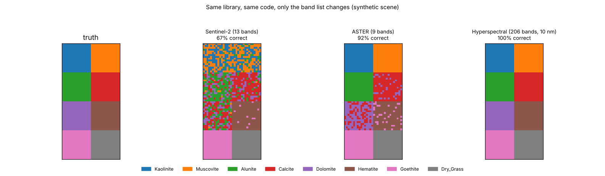
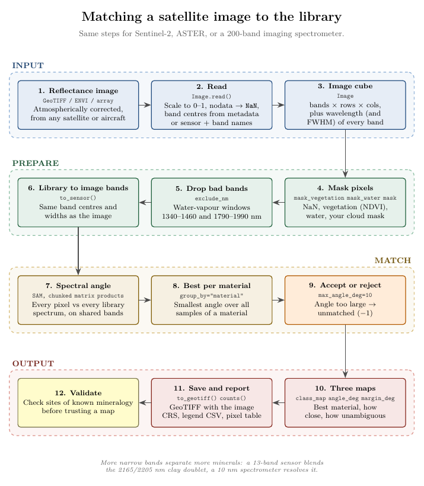
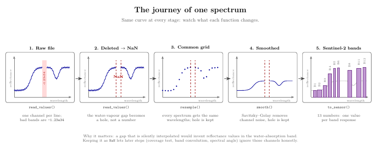
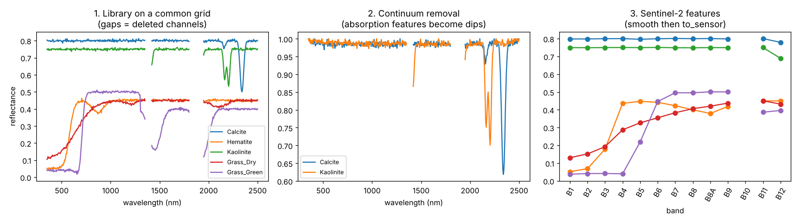

# usgs-splib07

[](https://colab.research.google.com/github/yamenetoo/RremoteSensing/blob/main/USGS/notebooks/splib07_colab.ipynb)

**Download the USGS Spectral Library Version 7, turn it into a clean machine-learning-ready library, preprocess spectra into features, and match satellite or airborne images (multispectral or hyperspectral) against it, in a few lines of Python.**

```python
from usgs_splib07 import download_splib07, build_library

root = download_splib07("data/")                                   # 1. download + extract
lib  = build_library(root, chapters="MSV", start=350, stop=2500, step=5)   # 2. one clean library
X    = lib.pipeline([("smooth", {}), ("to_sensor", {"sensor": "sentinel2a"})]).to_frame()  # 3. features
```

| You get | How |
|---|---|
| Resumable, verified download from USGS ScienceBase | `download_splib07()`, `splib07 download` |
| One library on a common wavelength grid, deleted channels kept as `NaN` | `build_library()` |
| NaN-aware preprocessing: resample, smooth, derivative, continuum removal, SNV / normalise | `SpectralLibrary` methods, `usgs_splib07.preprocess` |
| Convolution to Sentinel-2 or Landsat 8/9 bands (or your own sensor or SRF) | `to_sensor()`, `register_sensor()`, `convolve_srf()` |
| Indices, absorption depths, spectral-angle matching | `indices()`, `match()` |
| **Per-pixel mineral matching of any satellite/airborne image** (Sentinel-2, Landsat, ASTER, EnMAP-like hyperspectral, ...) | `Image.read()`, `match_image()`, `splib07 match` |
| Save and reload without pickle | `save()`, `SpectralLibrary.load()` |

Works the same on Windows, Linux and macOS. No `D:\` paths, no CSV index files.

---

## Contents

1. [Install](#install)
2. [Quick start](#quick-start)
3. [Satellite and airborne images](#satellite-and-airborne-images)
4. [How it works (flowcharts)](#how-it-works)
5. [Concepts in five minutes](#concepts-in-five-minutes)
6. [API cheat sheet](#api-cheat-sheet)
7. [Command line](#command-line)
8. [Examples](#examples)
9. [Sensors](#sensors)
10. [Accuracy and limitations](#accuracy-and-limitations)
11. [Project layout and development](#project-layout-and-development)
12. [Citation](#citation)

---

## Install

```bash
cd USGS
pip install -e .                 # core: numpy, scipy, pandas, requests
pip install -e ".[progress]"     # + tqdm progress bar for downloads
pip install -e ".[plot]"         # + matplotlib (used by the example figures)
pip install -e ".[geo]"          # + rasterio (read/write GeoTIFF and ENVI images)
pip install -e ".[dev]"          # + pytest
```

Python 3.9 or newer. The package is imported as `usgs_splib07`; the command is `splib07`.

## Quick start

**1. Download.** The first command lists what ScienceBase offers, the second downloads and extracts it.

```bash
splib07 list-remote
splib07 download data/                 # prefers the smaller oversampled ASCII archive
splib07 download data/ --full          # or the full usgs_splib07.zip (about 5 GB)
```

**2. Build one library.**

```python
from usgs_splib07 import build_library

lib = build_library(
    "data/data",              # folder that contains ASCIIdata/
    library="splib07b",       # oversampled version (recommended)
    chapters="MSV",           # Minerals, Soils, Vegetation (None = all seven)
    kinds=("AREF",),          # absolute reflectance
    start=350, stop=2500, step=5,   # common grid in nm
)
print(lib)                    # SpectralLibrary(n=..., bands=431, 350-2500 nm, ...)
lib.meta.head()               # name, material, sample, chapter, family, kind, path
lib.save("splib07_vnir_swir.npz")
```

**3. Make features.**

```python
from usgs_splib07 import SpectralLibrary

lib = SpectralLibrary.load("splib07_vnir_swir.npz")

s2 = lib.pipeline([
    ("smooth", {"window": 11, "poly": 3}),
    ("to_sensor", {"sensor": "sentinel2a"}),      # 13 bands named B1 ... B12
    ("normalized", {"method": "l2"}),
])
X = s2.to_frame(include_meta=False)               # n x 13 feature table
y = s2.meta["chapter"]                            # labels for a classifier
```

Every method returns a **new** library and records itself in `lib.history`, so the original is never modified.

## Satellite and airborne images

The same library can be compared with **any** reflectance image, because the only thing the matcher needs from an image is the centre wavelength (and, if known, the width) of each band. That covers broad-band multispectral sensors and imaging spectrometers with hundreds of bands alike.

```python
from usgs_splib07 import Image, SpectralLibrary

lib = SpectralLibrary.load("splib07_vnir_swir.npz")   # build with step=1 for narrow-band sensors

# Multispectral: name the sensor and the sensor band stored in each file layer
img = Image.read("s2_scene.tif", sensor="sentinel2a", scale=1e-4,
                 band_names=["B2", "B3", "B4", "B5", "B6", "B7", "B8", "B8A", "B11", "B12"])

# Hyperspectral: wavelengths are read from the file (ENVI or per-band tags) ...
img = Image.read("hyper_scene.tif", scale=1e-4)
# ... or given explicitly, with the band widths if you have them
img = Image.read("hyper_scene.tif", scale=1e-4, wavelengths=wl_nm, fwhm=fwhm_nm)

# Anything else (xarray, h5py, a Google Earth Engine export, NumPy): wrap the array
img = Image.from_array(cube, wl_nm, fwhm_nm, band_axis=0, scale=1e-4)

res = lib.match_image(img, group_by="material", max_angle_deg=10, mask_vegetation=0.4)
res.counts()            # pixels per material with mean angle and margin
res.class_map           # (rows, cols) index into res.labels, -1 = unmatched
res.angle_deg           # how close the best match is (lower = better)
res.margin_deg          # second-best minus best (higher = less ambiguous)
res.to_geotiff("minerals.tif")   # 3 bands + minerals_legend.csv, keeps the image CRS
```

Or from the command line: `splib07 match scene.tif lib.npz minerals.tif --scale 1e-4`.

What `match_image` does, in order: converts the library to the image's bands, drops unreliable bands (water-vapour windows, B10-type bands) and invalid, vegetated or masked pixels, computes the spectral angle of every pixel to every library spectrum on the bands both have, keeps the best spectrum per material, and leaves a pixel unmatched when its best angle is above `max_angle_deg`.

**Same code, different sensors.** On a synthetic scene (so the numbers only illustrate the principle), clays and carbonates that differ by narrow short-wave-infrared features are blended by broad bands but resolved by narrow ones:

| Sensor in the example | Bands | Overall accuracy |
|---|---|---|
| Sentinel-2 | 13 | 67% |
| ASTER (SWIR bands placed on the clay and carbonate features) | 9 | 92% |
| Imaging spectrometer, 10 nm bands | 206 | 100% |



Rules of thumb:

- **Input must be surface reflectance** (atmospherically corrected), scaled to about 0 to 1. Common scales: Sentinel-2 L2A `scale=1e-4`; Landsat Collection 2 Level-2 `scale=2.75e-5, offset=-0.2`. If the values look like integers and you gave no `scale`, `Image.read` stops with an explanation instead of guessing.
- **Check the angle and the margin, not only the class.** A pixel with a large angle or a tiny margin is a weak match. Mask vegetation, water, cloud and shadow (`mask_vegetation`, `mask_water`, `mask=` for your own cloud mask).
- **Hyperspectral products** (for example EnMAP, PRISMA, EMIT, AVIRIS) are not hard-coded because wavelengths differ per product. Use the file's metadata, or pass `wavelengths=` / `fwhm=`, or build a sensor with `sensor_from_wavelengths()`. NetCDF or HDF5 products are not read directly: load them with xarray or h5py and wrap with `Image.from_array`.
- **Validate on sites of known mineralogy** before trusting a map. Library spectra are pure laboratory samples; a pixel is usually a mixture.

## How it works

Read each chart top to bottom: each row is one phase and arrows follow the data.

**Chart 1: from download to features**


**Chart 3: matching a satellite image to the library**



The source of all three charts is [`docs/workflow.tex`](docs/workflow.tex) (TikZ). Build it with `pdflatex docs/workflow.tex`, or open [`docs/workflow.pdf`](docs/workflow.pdf).

## Concepts in five minutes

**Chart 2** follows **one spectrum** through the main steps.



| Term | Meaning here |
|---|---|
| **Chapter** | The library is split into seven chapters: `M` minerals, `S` soils and mixtures, `C` coatings, `L` liquids, `O` organics, `A` artificial, `V` vegetation. Use `chapters="MV"` to choose. |
| **Kind** | `AREF` absolute reflectance (default, values around 0 to 1), `RREF` relative reflectance. Choose with `kinds=`. |
| **Spectrometer family** | `BECK` (0.2-3.0 um), `ASD` (0.35-2.5 um), `NIC` (FTIR, to about 216 um), `AVIRIS`. Each has its own wavelength file; the package matches it for you. |
| **Deleted channel** | USGS marks bad bands with `-1.23e34`. They become `NaN` and are never interpolated across, so no invented reflectance values appear in water-absorption bands. |
| **Common grid** | Spectra from different instruments are resampled (linear, no extrapolation) onto one grid so they fit in one matrix. Spectra covering less than 90% of the grid are dropped (for example FTIR on a VNIR-SWIR grid). |
| **Sensor convolution** | A multispectral band is a weighted average of the hyperspectral channels under its response curve. `to_sensor()` does that for Sentinel-2 and Landsat 8/9. |
| **Continuum removal** | Divide by the upper convex hull so absorption features become dips between 0 and 1. Good for comparing mineral features independent of overall brightness. |
| **Spectral angle (SAM)** | Angle between two spectra seen as vectors. Independent of brightness, so a darker pixel of the same material still matches. |
| **Margin** | In image matching, the gap between the best and the second-best material angle. A small margin means the pixel is ambiguous. |

## API cheat sheet

**Build and load**

| Call | What it does |
|---|---|
| `download_splib07(dest)` | Download and extract; returns the folder to pass to `build_library`. |
| `list_remote_files()` | Files offered by ScienceBase (names, sizes, URLs). |
| `build_catalog(root, ...)` | DataFrame of spectrum files (no spectra read yet). |
| `build_library(root, ...)` | Read, resample and QC into a `SpectralLibrary`. |
| `SpectralLibrary.load(path)` / `.save(path)` | `.npz` round trip, no pickle. |

**`SpectralLibrary` methods** (each returns a new library)

| Method | What it does |
|---|---|
| `select(chapter="M", name_contains="calc")` | Subset by metadata or boolean mask. |
| `drop_invalid(min_valid_fraction)` / `clip(lo, hi)` | Quality control. |
| `resample(wavelengths, fwhm=None)` | New grid; `fwhm` gives Gaussian averaging for much coarser grids. |
| `to_sensor("sentinel2a")` | Convolve to sensor bands; columns get band names. |
| `smooth(window, poly)` / `derivative(order, window, poly)` | Savitzky-Golay, gaps preserved. |
| `continuum_removed()` / `snv()` / `normalized("l2")` | Shape features (`l2`, `max`, `minmax`, `area`). |
| `apply(fn, label)` | Your own step: `fn(wavelengths, X) -> X'`. |
| `pipeline([...])` | Run steps in order; each is a name or `(name, kwargs)`. |

**Outputs**

| Method | What it returns |
|---|---|
| `to_frame(include_meta=True)` | pandas DataFrame (metadata plus bands). |
| `indices(nd={...}, depths={...})` | Normalised differences like `{"ndvi": (842, 665)}` and absorption depths like `{"clay": (2120, 2205, 2260)}`. |
| `match(spectrum, k=5, query_wavelengths=None)` | Nearest library spectra by spectral angle (radians and degrees). |

**Images** (`usgs_splib07.imagery`)

| Call | What it does |
|---|---|
| `Image.read(path, sensor=, band_names=, wavelengths=, fwhm=, scale=, offset=, nodata=)` | Read a GeoTIFF/ENVI raster (needs rasterio). |
| `Image.from_array(cube, wavelengths, fwhm, band_axis=0, scale=, nodata=)` | Wrap any array. |
| `img.vegetation_mask()` / `img.water_mask()` / `img.normalized_difference(a_nm, b_nm)` | Simple masks and indices from the nearest bands. |
| `match_image(img, lib, group_by=, max_angle_deg=, exclude_nm=, mask=, mask_vegetation=, mask_water=)` or `lib.match_image(img)` | Per-pixel best material. |
| `MatchResult`: `.class_map` `.angle_deg` `.margin_deg` `.labels` `.counts()` `.names()` `.to_geotiff(path)` `.plot()` | Results. |
| `sensor_from_wavelengths(name, centers, fwhm)` / `subset_sensor(sensor, band_names)` | Describe a sensor from band centres, or keep some bands of a known one. |

Low-level functions (`resample`, `convolve_to_bands`, `convolve_srf`, `continuum_removal`, `spectral_angle`, ...) live in `usgs_splib07.preprocess` and work on plain NumPy arrays of shape `(n_spectra, n_bands)`.

## Command line

```bash
splib07 list-remote
splib07 download DEST [--full] [--pattern REGEX] [--no-extract]
splib07 build ROOT OUT.npz [--library splib07b] [--chapters MSV] [--kinds AREF|all] [--start 350 --stop 2500 --step 5]
splib07 info LIB.npz
splib07 features LIB.npz OUT.csv [--sensor sentinel2a] [--continuum] [--normalize l2]
splib07 match IMAGE LIB.npz OUT.tif [--scale 1e-4] [--sensor S --band-names B2,B3,...] [--wavelengths LIST_OR_FILE] [--fwhm N]
                                    [--group material|chapter|none] [--max-angle 10] [--veg-mask 0.4] [--water-mask 0.3]
```

## Examples

| File | What it shows | Needs internet |
|---|---|---|
| [`examples/01_synthetic_demo.py`](examples/01_synthetic_demo.py) | The whole pipeline on a tiny **synthetic** library: build, deleted-band handling, Sentinel-2 features, indices, spectral-angle matching, save and reload, figure. Runs in seconds. | No |
| [`examples/02_real_data.py`](examples/02_real_data.py) | Download the real library, build a VNIR-SWIR library, export a Sentinel-2 feature CSV, match a pixel. | Yes |
| [`examples/03_image_matching.py`](examples/03_image_matching.py) | Per-pixel matching of a **synthetic** scene seen by Sentinel-2, ASTER and a 206-band spectrometer, with accuracy per material and a figure. | No |

```bash
python examples/01_synthetic_demo.py
python examples/02_real_data.py data/
python examples/03_image_matching.py
```

The synthetic demo matches a noisy, darker, coarser-sampled "pixel" to the right mineral:

```
Best matches for an unknown pixel (should be Kaolinite):
                       name  material chapter  angle_rad  angle_deg
 Kaolinite_KGa1_ASDFRb_AREF Kaolinite       M     0.0154     0.8818
Calcite_HS48.3B_ASDFRb_AREF   Calcite       M     0.0658     3.7686
  Grass_Dry_GR2_ASDFRa_AREF Grass_Dry       V     0.2417    13.8492
```



In panel 3, band `B10` is empty on purpose: its wavelength (about 1373 nm) falls in a deleted water-vapour band, so it stays `NaN` instead of being invented.

## Sensors

| Sensor name (aliases) | Bands | Response model |
|---|---|---|
| `sentinel2a` (`sentinel2`, `s2`) | B1 to B12 including B8A (13 bands) | Gaussian, nominal centre and width |
| `landsat8` (`landsat9`, `oli`, `l8`, `l9`) | B1 to B7 and B9 (8 bands) | Box, nominal band edges |
| `aster` | B1, B2, B3N, B4 to B9 (9 VNIR and SWIR bands) | Box, nominal band edges |
| any imaging spectrometer | read from the file, or `sensor_from_wavelengths()` | Gaussian, width = FWHM or band spacing |

Add your own:

```python
from usgs_splib07 import Band, Sensor, register_sensor

register_sensor(Sensor("mycam", [Band("green", 550, 40), Band("red", 660, 40), Band("nir", 850, 60)]))
lib.to_sensor("mycam")
```

For an exact response curve use `usgs_splib07.preprocess.convolve_srf(wl, X, srf_wl, srf_resp)` (one band at a time).

## Accuracy and limitations

- **Approximate sensor responses.** Built-in bands use nominal centres and widths. Real responses are not Gaussian or box shaped. For exact values use `convolve_srf` with the official SRF, or use the USGS-provided convolved libraries (for example `s07SNTL2` for Sentinel-2).
- **Grid step.** Build with `step <= 5` nm before convolving to narrow bands (Sentinel-2 B5 and B6 are 15 nm wide). A warning is raised when the grid is too coarse.
- **Missing bands stay missing.** A sensor band is `NaN` when less than 80% of its response weight lies on valid channels.
- **No rescaling.** `AREF` values are already about 0 to 1. Small negative values from noise are kept unless you use `negative="nan"|"clip"` or `clip()`.
- **Download source.** File names and URLs are read from the ScienceBase JSON API at run time. If the preferred archive name (`ASCIIdata_splib07b`) is not offered, the full archive is used; run `splib07 list-remote` to see exactly what is available and pick one with `--pattern`.
- **Images.** Matching assumes surface reflectance and treats each pixel as one material (no unmixing). Mixed pixels, shadows, snow, moisture and poor atmospheric correction all raise the angle. Reading GeoTIFF/ENVI was tested on synthetic files; real EnMAP, PRISMA, EMIT and AVIRIS products were not tested, and NetCDF/HDF5 need to be loaded into arrays first.
- **Synthetic demos.** The accuracy table above comes from invented spectra and shows the principle, not what you will get on real scenes.
- **Library versions.** `splib07a` is the original sampling, `splib07b` the oversampled version, `s07*` are libraries convolved to other instruments. Wavelength vectors are matched by channel count, so all of them can be read.

## Project layout and development

```
USGS/
├── pyproject.toml
├── README.md
├── src/usgs_splib07/
│   ├── download.py     ScienceBase listing, resumable download, safe extraction
│   ├── catalog.py      scan ASCIIdata, parse file names, read spectra, find wavelengths
│   ├── preprocess.py   NaN-aware resample, convolve, smooth, derivative, continuum, SAM, indices
│   ├── sensors.py      Sentinel-2 and Landsat definitions, sensor registry
│   ├── library.py      SpectralLibrary and build_library
│   ├── imagery.py      Image (read/wrap rasters), masks, match_image, MatchResult
│   ├── synthetic.py    invented spectra and scenes for demos and tests
│   └── cli.py          the `splib07` command
├── examples/           01_synthetic_demo.py, 02_real_data.py, 03_image_matching.py
├── docs/               workflow.tex (TikZ), workflow.pdf, img/
└── tests/              pytest suite (uses a local mock server for the download tests)
```

```bash
pip install -e ".[dev]"
pytest                          # library, preprocessing, download and image tests (GeoTIFF tests need rasterio)
cd docs && pdflatex workflow.tex   # rebuild the flowcharts
```

## Citation

If you use the data, cite:

Kokaly, R.F., Clark, R.N., Swayze, G.A., Livo, K.E., Hoefen, T.M., Pearson, N.C., Wise, R.A., Benzel, W.M., Lowers, H.A., Driscoll, R.L., and Klein, A.J., 2017, USGS Spectral Library Version 7: U.S. Geological Survey Data Series 1035, https://doi.org/10.3133/ds1035. Data release: https://doi.org/10.5066/F7RR1WDJ.
